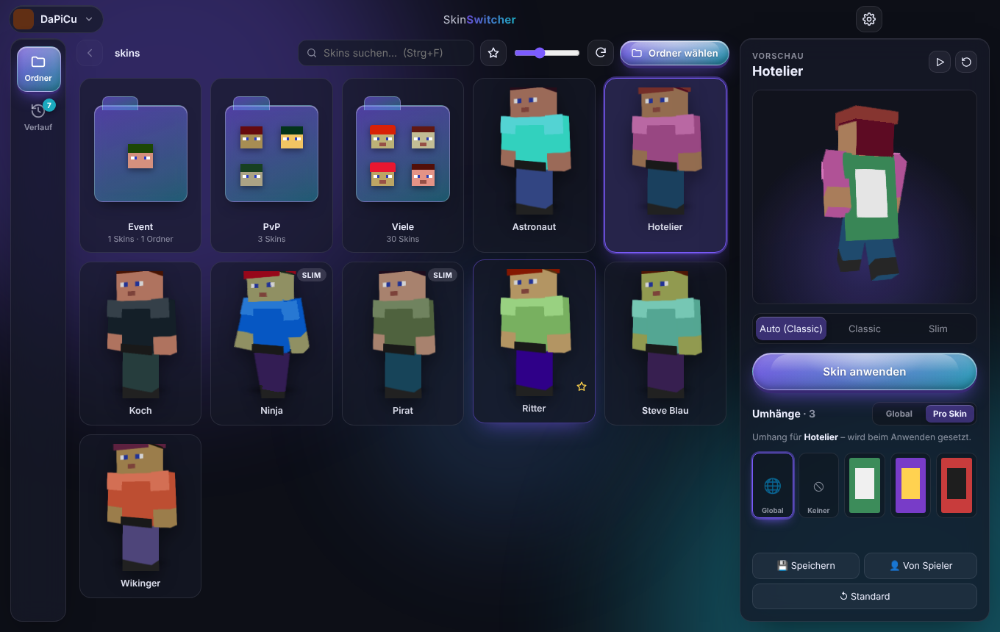
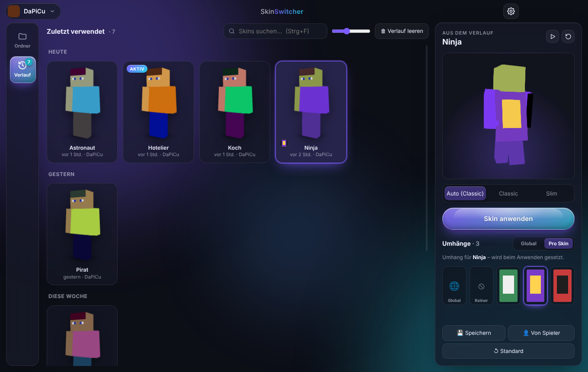
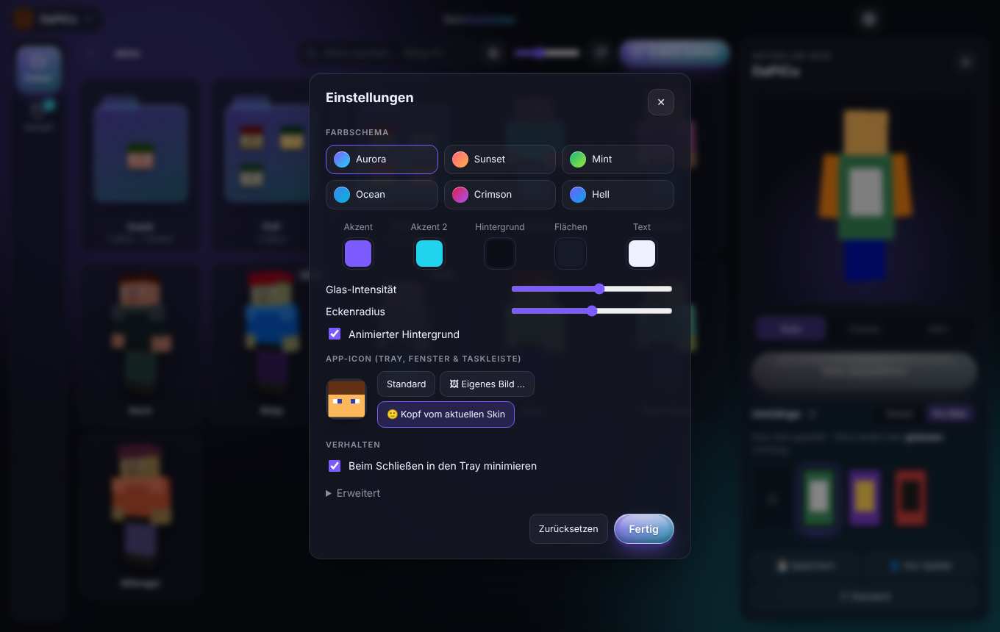
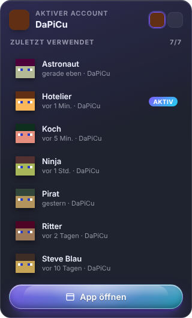

<div align="center">


# SkinSwitcher

**Minecraft-Skins & Umhänge wechseln – mit einem Klick, für mehrere Accounts.**

Skin-Ordner auswählen, Skin anklicken, fertig. Die Änderung geht direkt über die offizielle Minecraft-API an deinen Account.

[](https://github.com/DaPiCu/Skin-Changer/releases/latest)




</div>

---

## ✨ Features

### 🗂 Skin-Bibliothek
- **Ordner auswählen** → alle Skins (PNG, 64×64 / 64×32) werden als **3D-Figuren mit beiden Layern** angezeigt
- **Unterordner** erscheinen als eigene Ordner-Karten mit Kopf-Vorschau – Klick öffnet sie
- Figuren **laufen beim Drüberfahren** los, rechts gibt's die große **3D-Vorschau** (drehbar, mehrere Animationen)
- Suche, Favoriten, Kartengröße einstellbar, Ordner aktualisiert sich automatisch bei Änderungen
- **Classic / Slim** wird automatisch erkannt und kann pro Skin überschrieben werden
- „**AKTIV**“-Markierung am Skin, den du gerade trägst

### 👥 Mehrere Accounts
- Beliebig viele **Microsoft-Accounts** oben links hinzufügen und per Klick wechseln
- Login über das offizielle Microsoft-Anmeldefenster – Passwörter sieht die App nie
- Anmeldedaten werden **verschlüsselt** gespeichert (Windows DPAPI)

### 🧣 Umhänge
- Alle Umhänge deines Accounts anzeigen, wechseln oder ausblenden
- **Global**: ein Umhang für alle Skins (Standard)
- **Pro Skin**: jeder Skin merkt sich seinen eigenen Umhang – wird beim Anwenden automatisch mitgesetzt

### 🕘 Verlauf
- Jeder angewendete Skin landet im **Verlauf** (Tab links), gruppiert nach Heute / Gestern / Woche
- Mit einem Klick zurück zu einem alten Skin, auch wenn die Datei längst gelöscht ist

### 📌 Tray
- **Linksklick** aufs Tray-Icon → kleines Menü mit deinen **letzten Skins** – ein Klick und er ist drauf
- **Rechtsklick** → *App öffnen (FULL)* / *App schließen*
- Fenster schließen minimiert in den Tray (abschaltbar)

### 🎨 Design
- Moderner Look mit **Liquid-Glass-Buttons** und Tiefe
- **Farben frei einstellbar** + 6 Presets (Aurora, Sunset, Mint, Ocean, Crimson, Hell)
- **Eigenes App-Icon**: Standard, eigenes Bild oder automatisch der **Kopf deines aktuellen Skins**

### ➕ Extras
- Skin eines beliebigen Spielers **per Name laden** und speichern
- PNG per **Drag & Drop** ins Fenster ziehen
- Skin auf **Standard (Steve/Alex)** zurücksetzen

<div align="center">


<br/>

</div>

---

## 📥 Download & Installation

Lade die neueste Version unter **[Releases](https://github.com/DaPiCu/Skin-Changer/releases/latest)** herunter:

| Datei | Beschreibung |
|---|---|
| `SkinSwitcher-x.x.x-Setup.exe` | Installer mit Startmenü- & Desktop-Verknüpfung |
| `SkinSwitcher-x.x.x-Portable.exe` | Einzelne EXE, keine Installation nötig |

> **Windows-SmartScreen-Warnung?** Die EXE ist nicht signiert, deshalb erscheint beim ersten Start
> „Der Computer wurde durch Windows geschützt“. Klick auf **Weitere Informationen → Trotzdem ausführen**.

---

## 🚀 Benutzung

1. **Account hinzufügen** – oben links auf *Account hinzufügen* klicken und mit deinem Microsoft-Account anmelden
2. **Ordner wählen** – deinen Skin-Ordner auswählen (Unterordner werden automatisch erkannt)
3. **Skin anklicken** → Vorschau rechts prüfen → **Skin anwenden** (oder einfach **Doppelklick**)
4. **Umhang** in der Seitenleiste auswählen

> 💡 Der Skin wird **sofort** bei Mojang geändert. Ingame siehst du ihn nach einem **Rejoin** –
> Server laden Skins nur beim Betreten. Mojang hat außerdem ein Limit, wie oft man den Skin
> pro Minute ändern darf.

### ⌨️ Tastenkürzel

| Taste | Aktion |
|---|---|
| `Strg + 1` / `Strg + 2` | Ordner / Verlauf |
| `Strg + F` | Suche |
| `Enter` | Ausgewählten Skin anwenden |
| `Backspace` | Ordner nach oben |
| `F5` | Neu laden |
| `Esc` | Auswahl aufheben |
| `Strg + ,` | Einstellungen |

---

## ❓ FAQ

<details>
<summary><b>Ist das sicher? Was passiert mit meinem Account?</b></summary>

Die Anmeldung läuft über das offizielle Microsoft-Login-Fenster. Die App bekommt nur ein Token,
um Skins und Umhänge zu ändern – dein Passwort sieht sie nie. Die Tokens werden lokal und
verschlüsselt gespeichert und nirgendwohin gesendet außer an Microsoft/Mojang.
</details>

<details>
<summary><b>„Dieser Microsoft-Account hat kein Xbox-Profil“</b></summary>

Melde dich einmal auf <a href="https://www.xbox.com">xbox.com</a> an und lege ein Profil an, danach klappt der Login.
</details>

<details>
<summary><b>„Rate-Limit erreicht“</b></summary>

Mojang erlaubt nur wenige Skin-Änderungen pro Minute. Kurz warten und nochmal probieren.
</details>

<details>
<summary><b>Wo werden meine Daten gespeichert?</b></summary>

In `%APPDATA%\SkinSwitcher\` – `accounts.json`, `settings.json`, `history.json` und ggf. das eigene Icon.
Zum kompletten Zurücksetzen einfach den Ordner löschen.
</details>

<details>
<summary><b>Welche Skin-Dateien werden erkannt?</b></summary>

PNG-Dateien mit 64×64 (modern) oder 64×32 (alt) Pixeln. Andere Bilder im Ordner werden ignoriert.
</details>

---

## 🛠 Selbst bauen

Voraussetzung: [Node.js](https://nodejs.org) 20+

```bat
git clone https://github.com/DaPiCu/Skin-Changer.git
cd Skin-Changer
npm install
npm start
```

Oder einfach `start.bat` doppelklicken.

**EXE bauen:**

```bat
npm run build
```

→ Installer + Portable-EXE landen in `dist/`.

### Aufbau

```
main.js          Main-Prozess: Microsoft-Login, Minecraft-API, Dateisystem, Verlauf, Tray
preload.js       Sichere Brücke zwischen Main und Oberfläche
src/
  index.html     Hauptfenster
  renderer.js    Logik der Oberfläche
  skinrender.js  2D-/3D-Rendering der Skins (skinview3d)
  style.css      Design & Theme
  tray.*         Tray-Popup
assets/          App-Icons
```

**Tech:** [Electron](https://www.electronjs.org) · [skinview3d](https://github.com/bs-community/skinview3d) · [electron-builder](https://www.electron.build)

---

## ⚖️ Hinweis

SkinSwitcher ist ein inoffizielles Fan-Projekt und steht in keiner Verbindung zu Mojang Studios oder Microsoft.
Minecraft ist eine Marke von Mojang Studios.

Lizenz: [MIT](LICENSE) © DaPiCu
